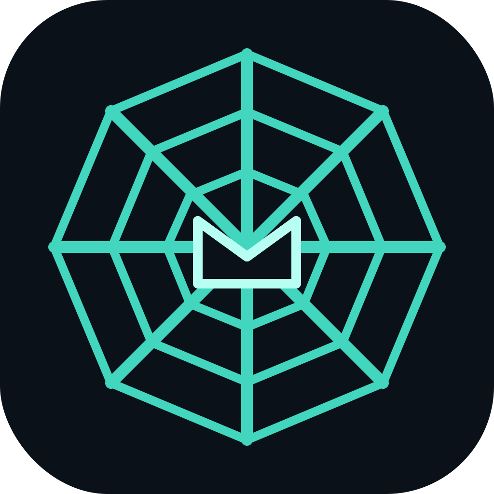

# Mailx for Android

An independent Android client for the [IVPN Mailx](https://github.com/ivpn/mailx) email-aliasing service. This repository contains the Android application and its Rust core; it is **not an official IVPN application** and is not endorsed by IVPN.

**Slogan:** Your inbox. Your privacy.

The client keeps the `Mailx` product identity and integrates with the official Mailx service. The official repository is tracked as an API/behavior upstream reference, not as a codebase to merge wholesale. See [docs/UPSTREAM.md](docs/UPSTREAM.md).

## Project characteristics

- Rust-first: application state, domain rules, security logic and the service client live in Rust.
- Compose-first UI: Jetpack Compose with Material 3 Expressive renders state and forwards user intent. Kotlin is limited to the UI and thin Android platform adapters.
- Existing Android package identity: `net.mailx.android` (kept for install/update compatibility).
- Offline-capable local analysis with server-backed Mailx account operations.
- Dark obsidian surfaces with a restrained teal accent and a geometric web/envelope app icon.

## Architecture

The Rust implementation is organized as seven Cargo crates: `mailx-domain`, `mailx-utils`, `mailx-security`, `mailx-network`, `mailx-application`, `mailx-runtime` and the Android-facing `mailx-core` facade. The app shell (route, open sheet, authentication, Back) is a typed state machine owned by Rust and exposed to Kotlin through UniFFI; stateless helpers and API calls still use the JSON JNI exports. Kotlin remains responsible for Android lifecycle, Compose rendering, widgets and platform services.

Read next: [docs/ARCHITECTURE.md](docs/ARCHITECTURE.md), [docs/UNIFFI.md](docs/UNIFFI.md) and the decision records in [docs/adr/](docs/adr/).

## Current status

[docs/STATUS.md](docs/STATUS.md) lists what is implemented, how it was verified, what is deliberately deferred and why, the findings of the first CI run, and the next steps.

## Main source areas

- `crates/`: six focused Rust capability crates.
- `rust-core/`: the `mailx-core` facade with the UniFFI API, the secure-store port and the JNI exports.
- `android-app/app/`: Compose screens, ViewModel, Android services, widgets, secure preferences and the JNI bridge.
- `assets/branding/`: editable brand artwork.
- `docs/`: architecture, status, decision records, upstream policy, branding and licensing notes; dated working logs are archived in `docs/history/`.
- `.github/`: workflows and reusable actions.

## Build

### Rust

The Rust release is pinned in `rust-toolchain.toml`.

```bash
cargo fmt --all -- --check
cargo clippy --workspace --all-targets --all-features -- -D warnings
cargo test --workspace --all-features
```

### Android

The Kotlin bindings for the typed core are generated from the compiled Rust library and are not committed. CI does this automatically (`.github/actions/generate-uniffi-bindings`); see [docs/UNIFFI.md](docs/UNIFFI.md) for the manual commands. Toolchain, SDK and workflow details are in [docs/BUILD_ENVIRONMENT.md](docs/BUILD_ENVIRONMENT.md).

CI builds the Rust libraries, checks 16 KB ELF alignment (including the libraries packaged in the APK), generates the bindings, assembles a debug APK and can run an emulator launch test on demand. The release workflow is gated by the Rust checks and publishes signed APKs with `SHA256SUMS.txt`. Release signing requires the following GitHub Actions secrets:

- `KEYSTORE_BASE64`
- `KEYSTORE_PASSWORD`
- `KEY_ALIAS`
- `KEY_PASSWORD` (optional; defaults to the keystore password)

The workflow intentionally fails if the private signing keystore is not configured. Never use a predictable or shared fallback signing key for release builds.

If CI warns that `Cargo.lock` is out of date, run the **Update Cargo.lock** workflow and keep its commit.

## Keep the official service connected

```bash
FORK_URL="https://github.com/<your-account>/<your-android-repo>.git" \
  ./scripts/setup-git-remotes.sh
```

This configures `origin` to your own Android repository and `upstream` to `https://github.com/ivpn/mailx.git`. The upstream project is the service (API, web app, mailserver and browser extension); review its API changes, but do not merge its repository tree into this Android repository. Full procedure: [docs/UPSTREAM.md](docs/UPSTREAM.md).

## Licensing and attribution

The official IVPN Mailx repository is GPL-3.0 licensed. This snapshot has no top-level license file and previously contained conflicting Cargo license metadata. The unverified Cargo `MIT` declaration was removed, and no project-wide license has been invented. Complete the provenance review before redistributing; see [docs/LICENSING_AND_ATTRIBUTION.md](docs/LICENSING_AND_ATTRIBUTION.md).

## Security

- Never commit `keystore.properties`, signing keys, access keys, session tokens or real account data.
- Do not log authentication material or message contents.
- Credentials are sent only to the server host the user entered, over HTTPS, and are never forwarded on redirects to another origin ([docs/adr/0002-network-host-and-credential-policy.md](docs/adr/0002-network-host-and-credential-policy.md)).
- Keep local-only analyzers usable without network access.
- Treat upstream API responses as untrusted input and validate them at the Rust boundary.
- Preserve existing secure-storage and Keystore behavior unless a separately tested migration is prepared ([docs/adr/0005-deferred-platform-security-work.md](docs/adr/0005-deferred-platform-security-work.md)).

## Brand assets



The launcher icon uses a geometric spider-web motif with an envelope at its center. Editable source: `assets/branding/mailx-web-mark.svg`. Brand tokens: [docs/BRANDING.md](docs/BRANDING.md). The Night Fjord design system is described in [docs/DESIGN_SYSTEM.md](docs/DESIGN_SYSTEM.md).
